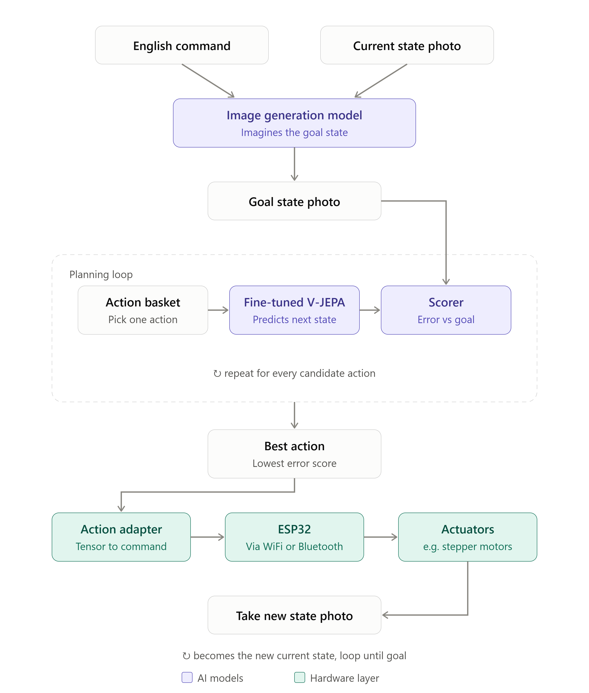

# V-JEPA Physical AI POC

Type a command in plain English and a low-cost rig carries it out. An image-generation model imagines the goal state; a fine-tuned V-JEPA 2-AC predictor scores every candidate action against that goal; the best action is sent to an ESP32 that drives stepper motors. A new photo is taken and the loop repeats until the goal is reached.



The modules and their acceptance criteria are in [backlog.md](backlog.md).

## Repository layout

This is a monorepo. One part is a library published to PyPI; the rest is specific to this POC.

```
vjepa-physical-ai-poc/
├── pyproject.toml                   # uv workspace root (not published)
├── backlog.md
│
├── packages/
│   ├── vjepa-byor/                  # core library, published to PyPI (backlog modules 2–4, 10, 12)
│   ├── vjepa-byor-esp32-stepper/    # our rig, built as a plugin (rig-specific parts of module 2 + module 7)
│   └── vjepa-byor-sim/              # simulated rig, also a plugin (module 11)
│
├── apps/                            # POC-specific, never published
│   ├── goal_generator/              # module 1
│   ├── planner/                     # modules 5 + 6 (scorer + planning loop)
│   ├── camera_service/              # module 8
│   └── dashboard/                   # module 9
│
├── configs/                         # actions, rig and fine-tuning settings
├── data/                            # gitignored datasets
├── checkpoints/                     # gitignored fine-tuned weights
└── docs/
```

### Core library: `packages/vjepa-byor/`

**vjepa-byor — Bring Your Own Robot:** fine-tune V-JEPA 2-AC to predict what your robot's actions will do.

It fine-tunes your pretrained V-JEPA on your own robot's (before, action, after) data, and includes the tools to define that action set and collect that data. Install with `pip install vjepa-byor`; import as `vjepa_byor`.

A **rig** is your robot setup: the actuators, the controller that drives them, and the camera that watches them. "Robot" is the public-facing word; "rig" is the term used in the code (`Rig`, `RigState`, `--rig`).

```
src/vjepa_byor/
├── interfaces.py          # Protocols: ActionSpace, RigState, VJepaMapping, CommandCodec,
│                          #   Transport, Camera, DataSource
├── rig.py                 # Rig bundle: groups a rig's pieces under one registered name
├── registry.py            # plugin discovery via Python entry points
├── actions/               # module 2 (generic parts)
│   ├── vocabulary.py      #   discrete action sets as tensors
│   ├── state.py           #   rig state schema
│   ├── adapter.py         #   action tensor ⇄ hardware command
│   ├── vjepa_mapping.py   #   rig action/state → V-JEPA 2-AC 7-D action/state format
│   └── codecs/            #   reusable wire formats (JSON line, G-code, …)
├── data/                  # module 3
│   ├── sample.py          #   (before photo, rig state, action, after photo)
│   ├── collector.py       #   runs any DataSource and records samples
│   ├── sources/           #   generic sources built on a Rig + Camera
│   ├── storage.py         #   on-disk format and manifest
│   └── dataset.py         #   torch Dataset, splits, export
├── predictor/             # module 4
│   ├── loading.py         #   loads V-JEPA 2-AC (pinned torch.hub commit, bf16)
│   ├── latent_cache.py    #   encodes the dataset once with the frozen encoder
│   ├── input_layers.py    #   optional custom-sized action/state input layers
│   ├── finetune.py        #   predictor-only fine-tuning
│   ├── lora.py            #   fallback if full fine-tuning does not fit in VRAM
│   ├── evaluate.py        #   vs "no change" baseline and vs the original predictor
│   └── inference.py       #   scores a whole action basket in one batch
├── testing/               # conformance tests and a fake in-memory transport for plugin authors
└── cli.py                 # vjepa-byor collect | encode | finetune | eval
```

### Rig plugins: `packages/vjepa-byor-<rig>/`

Every rig, including ours, is a plugin. A plugin provides:

| Piece | Implements | Required? |
|---|---|---|
| Action vocabulary | `ActionSpace` | Yes |
| Rig state | `RigState` | Yes |
| V-JEPA mapping | `VJepaMapping` | Yes, unless an existing mapping fits |
| Command codec | `CommandCodec` | Yes, unless a built-in one fits |
| Transport | `Transport` | Yes, unless a built-in one fits |
| Camera | `Camera` | Only if a generic webcam does not work |
| Device firmware | — | When the hardware needs custom code |

```
vjepa-byor-esp32-stepper/
├── pyproject.toml         # registers the rig via entry points
├── src/vjepa_byor_esp32_stepper/
│   ├── actions.py         # 8 directions × 3 step sizes, XY state
│   ├── mapping.py         # XY move → [dx, dy, 0, 0, 0, 0, 0]
│   ├── codec.py
│   ├── transport.py       # WiFi / Bluetooth
│   └── rig.yaml           # limits, step sizes, connection settings
├── firmware/              # PlatformIO project for the ESP32
└── tests/                 # runs the core library's conformance tests
```

A plugin registers itself in its `pyproject.toml`:

```toml
[project.entry-points."vjepa_byor.rigs"]
esp32-stepper = "vjepa_byor_esp32_stepper:Esp32StepperRig"
```

and is selected by name: `vjepa-byor collect --rig esp32-stepper`, or `--rig sim`.

## Design decisions

- **Dependencies point one way.** Plugins and apps import the core library; the core never imports them. The core contains no hardware code.
- **Our rig is a plugin, not a built-in.** It uses only the public interfaces. If the core has to change to make our rig work, a third party would have hit the same problem, so we fix the interface rather than add a special case.
- **The simulator is a plugin too.** The planner switches between simulation and hardware with `--rig`, with no code changes (backlog module 6).
- **Firmware lives with its plugin.** The ESP32 firmware and the Python codec share one wire format, so they are kept and tested together.
- **We fine-tune; we do not train.** The V-JEPA 2-AC encoder stays frozen. Only the predictor is fine-tuned, on latents encoded once ahead of time, so the encoder is not in GPU memory during fine-tuning.
- **Rig actions are mapped to V-JEPA 2-AC's 7-D format first.** For example, an XY move becomes `[dx, dy, 0, 0, 0, 0, 0]`, which reuses the pretrained action layers and needs less data. Custom-sized input layers (`input_layers.py`) are the fallback for rigs that do not map naturally.
- **Every sample records the rig state.** The predictor needs the current position along with each action, so the hardware reports its position after every move and the collector stores it.
- **V-JEPA weights are not bundled.** Users load them from Meta's sources into their own setup; the weights have their own license.
- **Built for 8 GB GPUs.** bf16 throughout, with LoRA on the predictor as the fallback if full fine-tuning does not fit.

## Hardware baseline

V-JEPA 2-AC (ViT-g encoder, 1,012M params; AC predictor, 305M params) has been verified on an RTX 4060 Laptop GPU (8 GB) with torch 2.11 + CUDA 12.8:

- Scoring 64 candidate actions in one batch takes about 0.9 s.
- Peak VRAM during inference is 5.4 GB.

## Open decisions

- Dataset format; the current plan is image folders plus a JSONL manifest
- License for this repository
